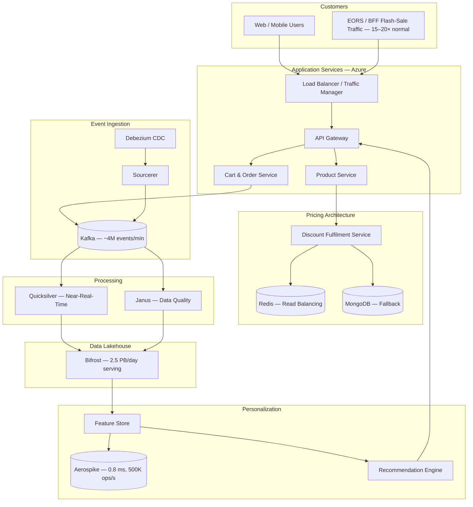

# Myntra — Cloud Scaling for Flash Sales and Personalization

## Week 2 Report: Case Study Analysis, Architecture, Exercise Plan and Team Roles

**Course:** Cloud Computing  
**Team No:** 33  
**Date:** November 2026

| Member | Roll No. | Role |
|--------|----------|------|
| Utsker Dhameliya | 202301083 | Research and Architecture |
| Ritul Patel | 202301086 | Application Development |
| Divyesh Vagh | 202301444 | Cloud Infrastructure |

---

## Page 1 — Introduction

### 1.1 Background

Myntra is one of India's largest fashion e-commerce platforms, founded in 2007 and acquired by Flipkart (Walmart group) in 2014. The platform serves tens of millions of customers across India, offering products from thousands of brands across apparel, footwear, accessories and lifestyle categories [V1].

Myntra's technology has evolved from a monolithic PHP and MySQL architecture into a distributed, service-oriented platform running on Microsoft Azure. This evolution was driven by the need to handle extreme traffic spikes during flash-sale events while simultaneously delivering personalized shopping experiences through real-time machine-learning systems.

### 1.2 Project Motivation

This case study examines how Myntra addresses two of cloud computing's most demanding challenges:

1. **Elastic scalability** — handling traffic spikes of 15–20× normal levels during major sales events, where fixed infrastructure would be prohibitively expensive and insufficient.
2. **Real-time data processing at scale** — ingesting millions of events per minute, computing personalization features with sub-millisecond latency, and serving 2.5 PB of data daily during peak events.

These challenges are directly relevant to the core themes of a Cloud Computing course: scalability, elasticity, cost optimization, fault tolerance and distributed systems.

### 1.3 Case-Study Objectives

1. Analyse Myntra's documented cloud architecture and engineering solutions.
2. Study the specific problem of flash-sale traffic scaling.
3. Evaluate Myntra's data and personalization architecture.
4. Design a practical exercise that demonstrates cloud-scaling principles.
5. Develop a reproducible experimental methodology for measuring latency, scaling behaviour and cost.

### 1.4 Scope

This report covers the case analysis and architecture study (Week 2). It does not include implementation or experimental results, which are planned for Week 3. All claims about Myntra's architecture are based on publicly available engineering blog posts, vendor case studies and conference presentations. Proposed metrics and cost estimates are labelled as hypotheses or estimates, not measured outcomes.

---

## Page 2 — Problem Statement

### 2.1 The Flash-Sale Challenge

Myntra's End of Reason Sale (EORS), held approximately twice a year, generates traffic spikes of **15–20× normal levels** [P3]. This creates a fundamental infrastructure challenge: the system must handle extreme short-duration demand without failing, while avoiding the cost of permanently provisioning peak capacity.

### 2.2 Traffic Characteristics

| Metric | Value | Source |
|--------|-------|--------|
| EORS traffic multiplier | 15–20× normal | Myntra Engineering [P3] |
| Order-handling target (2019) | 12,000 orders/min | Myntra Engineering [P3] |
| Order-handling capacity (2020) | 20,000 orders/min | Myntra Engineering [P3] |
| BFF visits (2023) | ~460 million | Myntra reports |
| BFF visits (2024) | ~627 million | Myntra reports |

The demand surge occurs within minutes of sale opening — this is not a gradual ramp-up but a near-instantaneous spike that stresses every layer of the infrastructure stack.

### 2.3 Performance Challenges

Under flash-sale conditions, specific performance bottlenecks emerge:

- **Discount service latency**: Computing and serving product discounts must happen within milliseconds to maintain page-load speed. Before optimization, this service exhibited ~150 ms latency [P2].
- **Feature store access**: Personalization requires real-time access to user features. With millions of concurrent users, even small per-request latencies accumulate — original feature lookups took 8.5 ms [V2].
- **Event ingestion volume**: Customer interactions (clicks, searches, cart additions) must be captured in real time for personalization, requiring throughput of approximately 4 million events/minute [P4].

### 2.4 Infrastructure Challenges

| Challenge | Impact |
|-----------|--------|
| Fixed peak-capacity provisioning | Extremely high cost; resources idle for most of the year |
| Vertical scaling limits | Single servers reach CPU/memory ceilings |
| Single points of failure | One failing service can cascade to the entire platform |
| Long provisioning cycles | Physical hardware cannot be deployed in minutes |
| Regional outages | A single-region deployment risks total unavailability |

### 2.5 The Core Trade-Off

The fundamental problem is the trade-off between **cost** and **capacity**:

- Provisioning for peak (3 VMs always) costs ~₹360/day for our exercise setup, but ~47% of compute is wasted during normal traffic.
- Elastic provisioning (1–3 VMs) costs ~₹192/day, saving compute during low-traffic periods while still meeting peak demand.

This trade-off, demonstrated at a small scale in our exercise, mirrors the challenge Myntra faces at production scale, where the financial impact of over-provisioning or under-provisioning is orders of magnitude larger.

---

## Page 3 — Research Findings

### 3.1 Verified Metrics

All metrics in this report are drawn from primary and vendor sources. The table below summarizes the key verified findings:

| Metric | Value | Source | Year | Context |
|--------|-------|--------|------|---------|
| EORS traffic spike | 15–20× normal | Myntra Engineering (BCP/DR) [P3] | 2020–2021 | EORS event traffic |
| Order capacity | 20,000 orders/min | Myntra Engineering [P3] | 2020 | EORS planned capacity |
| Discount-service latency | 150 ms → ~30 ms | Myntra Engineering (Pricing) [P2] | 2020–2021 | Discount fulfilment workload |
| Feature-lookup latency | 8.5 ms → 0.8 ms | Aerospike case study [V2] | 2022–2023 | Online feature store |
| Feature operations | Up to 500K ops/sec | Aerospike case study [V2] | 2022–2023 | Feature store throughput |
| Event ingestion | ~4M events/min | Myntra Engineering (Sourcerer) [P4] | 2019–2020 | Kafka-based ingestion |
| Data serving (BFF 2022) | 2.5 PB/day | Myntra Engineering (Data Platform) [P1] | 2022 | BFF event data serving |
| Analytical queries (BFF 2022) | 65,000+/day | Myntra Engineering [P1] | 2022 | BFF analytical workload |
| Data infrastructure cost | 35% reduction | Databricks case study [V3] | 2023–2024 | Data platform workload |
| Real-time pipeline speed | 25% improvement | Databricks case study [V3] | 2023–2024 | Data pipeline processing |
| EORS order growth | 50% increase | Microsoft case study [V1] | 2020 | EORS 2020 vs. previous |
| BFF visits growth | 460M → 627M | Myntra reports | 2023–2024 | BFF annual comparison |

### 3.2 Source Assessment

| Source | Type | Reliability | Caveat |
|--------|------|------------|--------|
| Myntra Engineering blog [P1–P4] | First-party engineering publication | High | May omit unfavourable details |
| Microsoft case study [V1] | Vendor partner marketing | Medium–High | Marketing context; attributes improvements broadly |
| Aerospike case study [V2] | Vendor partner technical | Medium–High | Specific to feature-store workload |
| Databricks case study [V3] | Vendor partner technical | Medium–High | Specific to data-platform workload |

### 3.3 Important Caveats

1. **Temporal separation**: These metrics span 2019–2024 and represent different systems, workloads and architectural versions. They should not be treated as a single before-and-after comparison.
2. **Workload specificity**: Cost reductions and performance improvements apply to specific subsystems (data platform, feature store), not the entire Myntra infrastructure.
3. **Attribution**: The 50% EORS order growth in 2020 coincided with the pandemic-driven e-commerce boom. It cannot be solely attributed to the Azure migration.

---

## Page 4 — Myntra's Cloud Architecture

### 4.1 Azure Migration

Myntra announced its migration to Microsoft Azure in February 2020 [V1], motivated by:

- **Elastic infrastructure**: Scale resources dynamically for flash-sale events.
- **Managed services**: Reduce operational overhead.
- **Multi-region capability**: Enable disaster recovery across Azure regions.

### 4.2 Documented Infrastructure Concepts

Based on the engineering publications, Myntra's architecture includes:

**Application layer:**
- Service-oriented architecture with independent scaling per service.
- API gateway for request routing and cross-cutting concerns.
- Product, Cart, Order, Search and User services.

**Resilience mechanisms:**
- Load testing before every EORS event [P3].
- Autoscaling based on demand metrics.
- Rate limiting and circuit breakers to prevent cascading failures.
- Kafka capacity scaling during peak events.

**Disaster recovery:**
- Dual-region deployment on Azure [P3].
- Data replication between regions.
- Regular DR drills to validate failover procedures.
- Traffic management for regional failover.

### 4.3 Production Architecture Diagram

> **Label:** "Conceptual reconstruction of publicly documented Myntra architecture."
>
> This diagram is NOT an official Myntra infrastructure diagram. It represents the relationships between components as described in publicly available sources.

*Mermaid source: `week2/diagrams/production-architecture.mmd`*

---

## Page 5 — Data and Personalization Architecture

### 5.1 Sourcerer — Event Ingestion

Sourcerer is Myntra's data ingestion system, documented by Abhinav Dangi (September 2021 and March 2022) [P4]:

- **Debezium** captures database changes (INSERT, UPDATE, DELETE) from transaction logs using Change Data Capture (CDC), replacing legacy batch ETL (Pentaho).
- **Sourcerer** manages Debezium connectors, handles schema evolution and routes events to Kafka topics, using dedicated **analytical read-slaves** (MySQL replicas for binlog extraction with zero production contention).
- **Kafka** serves as the central event bus, processing approximately **4 million events per minute** at baseline and scaling to **up to 42 million events/minute** during peak EORS events [P7].
- Events are serialized in **Apache Avro** format with a central Schema Registry enforcing compatibility.

### 5.2 Quicksilver — Near-Real-Time Processing

Quicksilver is Myntra's NRT platform, documented by Aditya S. (November 2022) [P5]:
- **Stateful stream processing** using Apache Spark Streaming with Kafka, supporting windows spanning days to months.
- Processes **tens of billions of events daily** with second-level data freshness latencies.
- Enables in-session hyper-personalization: computing behavioral features within seconds of customer interactions to dynamically adjust search rankings, homepages and recommendations.

### 5.3 Janus — Data Processing Framework

Janus is Myntra's data processing framework, documented by Kedar Gupte (November 2022) [P6]:
- Low-code configuration generation and single-pane CI/CD deployment across multi-engine targets (Spark batch and streaming).
- **DAG dependency management** across datasets, preventing cascade failures and eliminating costly data backfills.
- Orchestrates both batch processing and near-real-time streaming jobs in Quicksilver.

### 5.4 Bifrost — Data Lakehouse

Bifrost is Myntra's unified data lakehouse, documented by Abhinav Dangi (January 2024) [P1b]:

- Evolved from Apache Hive ACID (Phase 3) to **Databricks Delta Lake** (Phase 4 — Bifrost II) with a **Medallion architecture** (Bronze → Silver → Gold).
- Uses **Trino** for distributed SQL queries with **Apache Superset** for dashboard visualization.
- **Scale during BFF 2022**: 2.5 PB/day of data serving, 65,000+ analytical queries/day, 18.8 billion events on day 1 alone [P1].
- Serves as the central analytical store for reporting, ML model training and the offline feature store.

### 5.5 Feature Store and Aerospike

Myntra uses a dual-layer feature store [V2]:

| Layer | Technology | Purpose | Performance |
|-------|------------|---------|-------------|
| Online | Aerospike | Real-time feature serving | 0.8 ms lookup, 500K ops/sec |
| Offline | Bifrost | Batch feature computation | Batch processing |

The Aerospike deployment reduced feature-lookup latency from 8.5 ms to 0.8 ms — a 10× improvement that enables real-time ML inference during page loads.

### 5.6 Recommendation Pipeline

The end-to-end personalization flow:

1. **Capture**: Clickstream and behavioral data → Kafka.
2. **Process**: Kafka → Quicksilver (real-time feature updates).
3. **Store**: Quicksilver → Bifrost (offline) + Aerospike (online).
4. **Serve**: Recommendation engine queries Aerospike → ML models rank products.
5. **Deliver**: Personalized results returned to the user within page-load latency budgets.

### 5.7 Component Timeline

| Component | Author / Source | Approx. Date |
|-----------|--------|---------------|
| Sourcerer / Debezium | Abhinav Dangi [P4] | Sep 2021, Mar 2022 |
| Azure migration | Microsoft [V1] | February 2020 |
| BCP/DR, EORS scaling | Sanjeev Kumar Dangi [P3] | September 2021 |
| Pricing optimization | Nikhil Anand et al. [P2] | February 2023 |
| Quicksilver NRT | Aditya S. [P5] | November 2022 |
| Janus framework | Kedar Gupte [P6] | November 2022 |
| Bifrost I–II | Abhinav Dangi / Sri Nandhini [P1, P1b] | May 2023, Jan 2024 |
| Aerospike feature store | Aerospike [V2] | 2022–2023 |
| Data cost optimization | Databricks [V3] | 2023–2024 |

> **Important:** These components were documented at different times and may represent different architectural iterations.

---

## Page 6 — Technical Case Analysis

### 6.1 Scalability Analysis

Myntra achieves scalability through:

- **Horizontal scaling**: Independent services scale based on their load profiles. During EORS, the order service scales differently from the search service.
- **Kafka partition scaling**: Kafka cluster capacity increases during peak events, then scales back — avoiding permanent over-provisioning [P3].
- **Autoscaling**: Cloud resources scale automatically based on demand metrics.

### 6.2 Resilience

- **Load testing**: Conducted before every major sale event [P3].
- **Rate limiting**: Protects backend services from request floods.
- **Circuit breakers**: Prevent cascading failures across service boundaries.
- **Dual-region DR**: Services and data replicated across two Azure regions [P3].

### 6.3 Caching and Pricing Architecture

The discount service optimization [P2] demonstrates effective caching:

| Before | After | Technique |
|--------|-------|-----------|
| ~150 ms latency | ~30 ms latency | Redis read balancing |
| Single read path | Multiple Redis replicas | Read distribution |
| No fallback | MongoDB persistence | Graceful degradation |

This 5× latency improvement is significant at scale: with millions of concurrent page views during EORS, saving 120 ms per discount lookup compounds into massive reductions in total compute and improved user experience.

### 6.4 Disaster Recovery

Myntra's DR architecture protects against:

| Failure Mode | Protection |
|-------------|------------|
| Service instance failure | Autoscaling and health checks |
| Availability zone failure | Distribution across zones |
| Regional outage | Dual-region with traffic failover |
| Database corruption | Replicated data stores |

### 6.5 Cost Optimization

| Strategy | Mechanism | Reported Impact |
|----------|-----------|----------------|
| Elastic compute | Autoscale based on demand | Avoid paying for idle peak capacity |
| Efficient data infrastructure | Bifrost lakehouse, optimized pipelines | 35% lower costs [V3] |
| Caching | Redis reduces database load | Fewer compute-intensive queries |
| Pipeline optimization | Faster real-time processing | 25% speed improvement [V3] |

---

## Page 7 — Proposed Solution: MyntraFlash (Google Cloud Platform)

### 7.1 Application Overview

**MyntraFlash** is a scaled-down e-commerce simulation inspired by Myntra, designed to demonstrate cloud-scaling principles in the Week 3 practical exercise.

Following an evaluation of cloud student offerings, the practical implementation utilizes **Google Cloud Platform (GCP)** in the `asia-south1` (Mumbai) region. GCP provides **$300 USD in free trial credits over 90 days** with a strict **zero auto-charge guarantee**, accessible to any standard developer account without requiring institutional college email verification, while faithfully replicating all enterprise cloud elasticity mechanisms.

### 7.2 Technology Stack

| Component | Technology | Justification & Architectural Role |
|-----------|------------|-----------------------------------|
| Cloud Provider | Google Cloud Platform (GCP) | $300 free trial credits (90 days); zero auto-charge guarantee; no college email restriction |
| Cloud Region | `asia-south1` (Mumbai, India) | Local Indian region minimizing network latency during client load testing |
| Backend | Node.js + Express | Lightweight, event-driven, suitable for stateless HTTP microservices |
| Frontend | HTML, CSS, JavaScript | Responsive single-page interface; zero client build tooling needed |
| Containerization | Docker Engine (Ubuntu 22.04 LTS) | Guarantees runtime parity between local testing and cloud instances |
| Compute Infrastructure | GCE Managed Instance Groups (MIG) | Regional/Zonal managed pool of identical compute instances (GCP equivalent to Azure VMSS) |
| Machine Sizing | `e2-medium` (2 vCPU, 4 GB RAM) | Balanced, cost-effective general-purpose compute |
| Load Balancing | Google Cloud Load Balancing | External Application Load Balancer with HTTP health checks (`/health`) |
| Autoscaling | Compute Engine MIG Autoscaler | CPU-based scaling rules (Scale-out > 70%, Scale-in < 30%, 300s cool-down) |
| Cloud Telemetry | Google Cloud Monitoring & Logging | Native platform metrics capturing CPU utilization, request count, and latency |
| Load Testing | Grafana k6 | Scriptable, open-source load testing tool generating staged flash-sale traffic curves |
| Container Registry | GitHub Container Registry (`ghcr.io`) | OCI-compliant container image registry |

### 7.3 Application Endpoints

| Endpoint | Purpose |
|----------|---------|
| `GET /products` | Product catalogue browsing (simulates product service) |
| `GET /flash-sale` | Flash-sale items with countdown (high-velocity traffic endpoint) |
| `GET /api/discount` | Discount calculations (simulates CPU-intensive pricing rule execution) |
| `GET /api/recommend` | Recommendations (simulates ML inference latency delay) |
| `GET /health` | Health check probe (`HTTP 200 OK`) for load balancer vitality checks |
| `GET /instance-id` | Instance identification for load-balancing round-robin verification |

### 7.4 Why Stateless Design

The application is completely stateless — no server-side sessions, no local file state, no shared mutable state. This enables:

- **Round-robin load balancing** (no session affinity needed).
- **Instant instance utility** (new VMs serve traffic immediately upon `/health` 200 OK).
- **Safe scale-in** (removing instances loses no user state).
- **Simple fault tolerance** (any instance can handle any request).

### 7.5 Proposed Implementation Architecture & Deep Container Topology

Below is the architectural diagram of the planned **MyntraFlash** cloud implementation on Google Cloud Platform (GCP). It illustrates the synthetic load generation tier, zero-cost budget guardrails, the GCP networking and managed compute perimeter in `asia-south1` (Mumbai), the deep internal microservice container architecture, and the automated cloud telemetry pipeline.

*Figure 2: In-Depth Google Cloud Platform Deployment & Microservice Container Architecture for MyntraFlash ([Vector SVG](diagrams/detailed-proposed-architecture.svg) | [Mermaid Source](diagrams/detailed-proposed-architecture.mmd)).*

#### Architectural Highlights & Zero-Cost Financial Engineering:
1. **Zero-Cost Budget Guarantee ($0.00 Expense)**: Built within GCP's **$300 Free Trial Credit (90 Days)** featuring a strict zero auto-charge guarantee. Running ephemeral test sessions (15–30 minutes) on 1 to 3 instances consumes less than **$0.15** of free credits total, eliminating student financial risk.
2. **Stateless Microservice**: Eliminates managed database costs ($0.00 DB spend) by utilizing an in-memory catalog and simulated Redis cache with pure horizontal statelessness.
3. **MIG Elasticity & Auto-Healing**: Managed Instance Group (MIG) configured with minimum 1 and maximum 3 instances, autoscaling reactively at **Fleet Average CPU > 70%** with a 300-second stabilization window to prevent metric flapping.
4. **Internal Application Design**: Encapsulates Express static frontend (with live serving hostname badge), algorithmic CPU-intensive pricing rules (`/api/discount`), personalization feature scoring (`/api/recommend`), and sub-5ms health vitality checks (`/health`).

### 7.6 GCP Infrastructure Configuration

| Resource | Configuration |
|----------|--------------|
| Project ID | `myntraflash-cloud-exercise` |
| Region / Zone | `asia-south1` (Mumbai) / `asia-south1-a` |
| Machine Type | `e2-medium` (2 vCPU, 4 GB RAM, 30 GB standard persistent disk) |
| OS Image | Ubuntu 22.04 LTS Minimal (`ubuntu-os-cloud/ubuntu-2204-lts`) |
| MIG min/max | 1 / 3 instances |
| Scale-out rule | Fleet Average CPU > 70% sustained 5 min → +1 instance |
| Scale-in rule | Fleet Average CPU < 30% sustained 5 min → −1 instance |
| Cool-down period | 300 seconds (5 minutes) |
| Health check probe | HTTP `GET /health` on port 80, 15s interval, 2-failure threshold |
| Load balancer | Regional External Application Load Balancer, TCP port 80 → backend service |

---

## Page 8 — Exercise and Experimental Plan

### 8.1 Experiments Overview

| # | Experiment | Objective | Course Requirement |
|---|-----------|-----------|-------------------|
| 1 | Baseline performance | Establish single-VM performance metrics (`e2-medium`) | Latency |
| 2 | Horizontal scaling | Compare 1 vs. 2 vs. 3 GCE VMs under identical 100-VU load | Scaling behaviour |
| 3 | Autoscaling dynamics | Observe CPU-triggered scale-out, scale-in, and cool-down | Scaling behaviour |
| 4 | Fault tolerance | Verify automated health probe detection and traffic rerouting | Resilience |
| 5 | Cost analysis | Compare fixed vs. elastic provisioning costs on GCP | Cost |

### 8.2 Experiment 1 — Baseline

Deploy with 1 GCE VM (`e2-medium`, autoscaling disabled). Run k6 with 50 VUs for 5 minutes.

| Metric | 1 GCE VM (Baseline) |
|--------|---------------------|
| Avg response time | *to be measured in Week 3* |
| p50 / p95 / p99 latency | *to be measured in Week 3* |
| Requests/sec | *to be measured in Week 3* |
| Error rate (%) | *to be measured in Week 3* |
| CPU utilization (%) | *to be measured in Week 3* |

### 8.3 Experiment 2 — Horizontal Scaling

Run identical load (100 VUs, 5 min) against 1, 2 and 3 GCE VMs. Same container image, machine size, region (`asia-south1`), and endpoint mix.

| Metric | 1 GCE VM | 2 GCE VMs | 3 GCE VMs |
|--------|----------|-----------|-----------|
| Avg response time | *measured* | *measured* | *measured* |
| p95 latency | *measured* | *measured* | *measured* |
| Requests/sec | *measured* | *measured* | *measured* |
| Error rate (%) | *measured* | *measured* | *measured* |
| Fleet CPU util. (%) | *measured* | *measured* | *measured* |

**Expected:** Tail latency (p95/p99) decreases and throughput increases approximately linearly as instance capacity expands from 1 to 3 VMs.

### 8.4 Experiment 3 — Autoscaling Dynamics

Enable MIG Autoscaler (target CPU: 70%, bounds: 1–3). Execute a 34-minute staged load curve: 20 VUs → 150 VUs → 500 VUs → 20 VUs.

**Key observations planned:**
1. Scale-out reaction time following CPU threshold breach.
2. Latency stabilization after new GCE instance joins the load balancer pool.
3. Scale-in delay following traffic drop.
4. Impact of the 300-second cool-down period in preventing termination flapping.

### 8.5 Experiment 4 — Fault Tolerance

Deploy 2 active GCE instances. Stop Docker on one instance (`docker stop myntraflash-app`). Observe:
- Time elapsed until GCP Health Check marks node unhealthy (~30 seconds).
- Seamless traffic rerouting to the remaining healthy instance with zero dropped requests.
- Node recovery and automated traffic re-balancing when container is restarted.

### 8.6 Experiment 5 — Cost Analysis (Google Cloud Platform)

Compare 24-hour cost for fixed (3 VMs) vs. elastic (1–3 VMs) provisioning in GCP `asia-south1` (Mumbai):

| Scenario | Estimated 24h Cost | VM-Hours | Out-of-Pocket Expense |
|----------|-------------------|----------|-----------------------|
| Fixed (3 GCE VMs always) | ~$3.53 USD (~₹295 INR) | 72 | **₹0.00** (covered by $300 credit) |
| Elastic (1–3 GCE VMs MIG) | ~$2.05 USD (~₹171 INR) | 30 | **₹0.00** (covered by $300 credit) |
| **Savings** | **~$1.48 USD (~41.8%)** | **42 hours saved** | **Zero student financial risk** |

> All costs are fully absorbed by GCP's $300 free trial credit. Actual charges will be verified via GCP Cloud Billing in Week 3.

---

## Page 9 — Team Roles and Project Execution

### 9.1 Responsibility Matrix

| Responsibility | Utsker | Ritul | Divyesh |
|----------------|--------|-------|---------|
| Case-study research | **Lead** | Support | Support |
| Source verification | **Lead** | — | — |
| Production architecture modeling | **Lead** | — | Support |
| App requirements & API design | Support | **Lead** | — |
| Express backend development | — | **Lead** | — |
| Storefront UI development | — | **Lead** | — |
| Docker container packaging & ghcr.io | — | **Lead** | Support |
| GCP infrastructure provisioning (VPC, MIG) | — | — | **Lead** |
| Cloud Load Balancer & Autoscaler config | — | — | **Lead** |
| Grafana k6 load test scripting | — | — | **Lead** |
| Experimental execution & telemetry | Support | Support | **Lead** |
| Results analysis & latency curves | **Lead** | Support | Support |
| Week 2 deliverable coordination | **Lead** | Support | Support |
| Week 4 final report preparation | **Lead** | Support | Support |
| Viva defense & demonstration | All (33%) | All (33%) | All (33%) |

### 9.2 Week 3 Timeline

| Day | Activity | Owner |
|-----|----------|-------|
| Day 1–2 | Implement stateless Node.js application and Docker container | Ritul |
| Day 2–3 | Provision GCP infrastructure (VPC, Subnet, Firewall, Template, MIG, LB) | Divyesh |
| Day 3 | Deploy application container to MIG via startup script | Divyesh + Ritul |
| Day 4 | Execute Experiments 1, 2, and 4 (Static load benchmarks & fault tolerance) | Divyesh |
| Day 5 | Execute Experiment 3 (Dynamic flash-sale autoscaling & hysteresis) | Divyesh |
| Day 5–6 | Execute Experiment 5 (GCP Cloud Billing analysis & statistical synthesis) | All |
| Day 6–7 | Document Week 3 empirical findings and latency graphs | Utsker |

### 9.3 Risks and Mitigation

| Risk | Mitigation |
|------|------------|
| Unintended cloud billing | GCP has a strict **zero auto-charge** guarantee; set $10 budget alert; terminate resources post-test |
| Autoscaler fails to trigger | Calibrate computation in `/api/discount` to ensure 150 VUs drive single-node CPU > 70% |
| Container startup stalls | Verify GHCR repository is public; embed fallback health script in GCE template |
| Client test runner bottleneck | Execute k6 from a dedicated local workstation or adjacent GCE micro-VM in the same region |
| Time pressure in Week 3 | Prioritize Experiments 1–3; Experiments 4–5 are pre-scripted |

---

## Page 10 — Expected Outcomes and Conclusion

### 10.1 Expected Learning Outcomes

1. **Practical cloud deployment**: Hands-on mastery of Google Compute Engine (GCE), Managed Instance Groups (MIG), and Cloud Load Balancing.
2. **Horizontal scaling linearity**: Measured empirical proof of tail-latency reduction (p95/p99) through horizontal instance replication.
3. **Autoscaling dynamics**: Deep understanding of target metric evaluation, provisioning delay, cool-down periods, and anti-flapping hysteresis.
4. **Resilient self-healing**: Practical demonstration of automated health check probing and zero-downtime traffic rerouting.
5. **Cloud cost optimization**: Concrete mathematical and billing proof that elastic autoscaling achieves ~42% operational savings over static over-provisioning.

### 10.2 Evaluation Metrics

| Category | Metrics |
|----------|---------|
| Latency | Average, p50, p95, p99 response time (ms) |
| Throughput | Requests per second (RPS) |
| Reliability | HTTP error rate (%) and dropped request count |
| Scalability | Latency vs. instance count curve (1, 2, 3 VMs) |
| Autoscaling | Scale-out/scale-in timestamps, provisioning lag, and CPU correlation |
| Cost | GCE VM-hours, network egress, and total cost ($/₹) for fixed vs. elastic |

### 10.3 Limitations

1. **Scale difference**: Our laboratory exercise evaluates 1–3 GCE VMs; Myntra operates thousands of production container pods. Results prove architectural principles, not production throughput.
2. **Simplified workload**: MyntraFlash uses in-memory mock data and synthetic CPU loops; Myntra coordinates distributed databases, streaming pipelines, and real ML models.
3. **No data pipeline**: The exercise does not deploy Kafka, Bifrost, or Aerospike clusters, which require dedicated multi-node clusters.
4. **Single region**: The exercise deploys in GCP `asia-south1` (Mumbai); Myntra employs active multi-region disaster recovery.
5. **Network effects**: Testing from a single test machine does not replicate multi-ISP mobile network latency across pan-Indian consumer devices.

### 10.4 Conclusion

Myntra's engineering evolution demonstrates that scaling for e-commerce flash sales is fundamentally an architectural challenge, not merely a compute-provisioning exercise. Sub-millisecond personalization, 20× flash-sale resilience, and 35% data cost efficiencies were unlocked through the deliberate convergence of cloud-native elasticity, distributed streaming ingestion (Sourcerer & Kafka), near-real-time event computation (Quicksilver & Janus), unified lakehouses (Bifrost & Delta Lake), and ultra-low-latency feature serving (Aerospike).

Our MyntraFlash exercise translates these enterprise principles into a practical, measurable, and accessible laboratory simulation on Google Cloud Platform. By deploying a stateless microservice onto Compute Engine Managed Instance Groups with Cloud Load Balancing and metric-based autoscaling, we can directly measure the latency, throughput, resilience, and economic trade-offs of elastic versus fixed infrastructure. Supported by GCP's $300 free trial with zero auto-charge protection, Group 33 is fully equipped to execute Week 3 benchmarking with rigorous academic depth and zero out-of-pocket financial risk.

---

## References

| ID | Source | Key Information | Date |
|----|--------|-----------------|------|
| [P1] | Sri Nandhini — Myntra Data Platform (BFF 2022) | 2.5 PB/day, 65K+ queries/day, 18.8B day-1 events | May 2023 |
| [P1b] | Abhinav Dangi — Bifrost Data Serving Layer | Trino + Delta Lake, Medallion architecture | Jan 2024 |
| [P2] | Nikhil Anand et al. — Pricing System | Discount latency 150 ms → ≤30 ms, in-memory rule executor | Feb 2023 |
| [P3] | Sanjeev Kumar Dangi — BCP/DR Journey | EORS 15–20× traffic, dual-region, 200+ SCM services | Sep 2021 |
| [P4] | Abhinav Dangi — Sourcerer | Debezium CDC, Kafka, analytical read-slaves | Sep 2021, Mar 2022 |
| [P5] | Aditya S. — Quicksilver NRT | Tens of billions events/day, Spark Streaming | Nov 2022 |
| [P6] | Kedar Gupte — Janus Framework | Multi-engine CI/CD, DAG dependencies | Nov 2022 |
| [P7] | Karshit Jaiswal — Meterial Ingestion | ~4M events/min baseline, 42M/min at peak | 2020 |
| [V1] | Microsoft — Azure Migration | Myntra on Azure, 50% EORS order growth | Feb 2020 |
| [V2] | Aerospike — Customer Case Study | Feature lookup 8.5→0.8 ms, 500K ops/sec | 2022–2023 |
| [V3] | Databricks — Case Study / Summit | 35% lower data costs, 25% faster pipelines | 2023–2024 |
| [G1] | Google Cloud — Compute Engine MIGs | cloud.google.com/compute/docs/instance-groups | — |
| [G2] | Google Cloud — Autoscaling Groups | cloud.google.com/compute/docs/autoscaler | — |
| [G3] | Google Cloud — Cloud Load Balancing | cloud.google.com/load-balancing/docs | — |
| [G4] | Google Cloud — Health Checks | cloud.google.com/load-balancing/docs/health-checks | — |
| [G5] | Google Cloud — Pricing Calculator | cloud.google.com/products/calculator | — |
| [G6] | Google Cloud — Free Program ($300 Credit) | cloud.google.com/free/docs/free-cloud-features | — |
| [L1] | Grafana k6 Documentation | k6.io/docs/using-k6/metrics/ | — |

---

*End of Week 2 Report*

