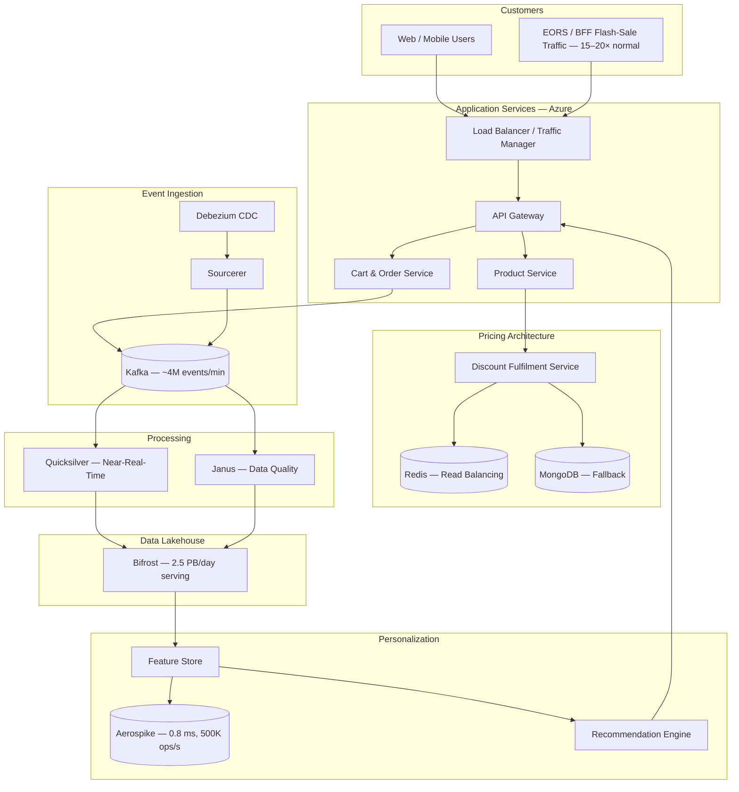
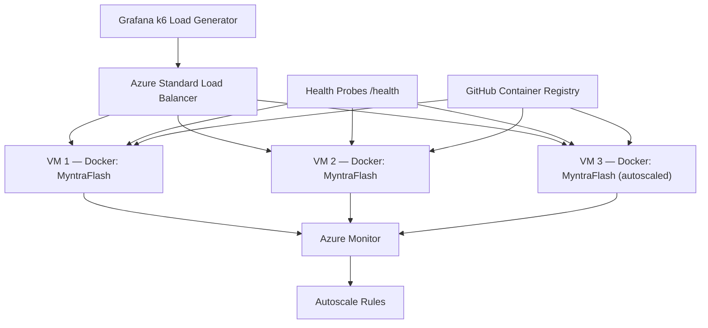

# Myntra — Cloud Scaling for Flash Sales and Personalization

## Week 2 Report: Case Study Analysis, Architecture, Exercise Plan and Team Roles

**Course:** Cloud Computing  
**Team No:** 33  
**Date:** November 2026

| Member | Roll No. | Role |
|--------|----------|------|
| Utsker Dhameliya | 202301083 | Research and Architecture |
| Ritul Patel | 202301086 | Application Development |
| Divyesh Vagh | 202301444 | Cloud Infrastructure |

---

## Page 1 — Introduction

### 1.1 Background

Myntra is one of India's largest fashion e-commerce platforms, founded in 2007 and acquired by Flipkart (Walmart group) in 2014. The platform serves tens of millions of customers across India, offering products from thousands of brands across apparel, footwear, accessories and lifestyle categories [V1].

Myntra's technology has evolved from a monolithic PHP and MySQL architecture into a distributed, service-oriented platform running on Microsoft Azure. This evolution was driven by the need to handle extreme traffic spikes during flash-sale events while simultaneously delivering personalized shopping experiences through real-time machine-learning systems.

### 1.2 Project Motivation

This case study examines how Myntra addresses two of cloud computing's most demanding challenges:

1. **Elastic scalability** — handling traffic spikes of 15–20× normal levels during major sales events, where fixed infrastructure would be prohibitively expensive and insufficient.
2. **Real-time data processing at scale** — ingesting millions of events per minute, computing personalization features with sub-millisecond latency, and serving 2.5 PB of data daily during peak events.

These challenges are directly relevant to the core themes of a Cloud Computing course: scalability, elasticity, cost optimization, fault tolerance and distributed systems.

### 1.3 Case-Study Objectives

1. Analyse Myntra's documented cloud architecture and engineering solutions.
2. Study the specific problem of flash-sale traffic scaling.
3. Evaluate Myntra's data and personalization architecture.
4. Design a practical exercise that demonstrates cloud-scaling principles.
5. Develop a reproducible experimental methodology for measuring latency, scaling behaviour and cost.

### 1.4 Scope

This report covers the case analysis and architecture study (Week 2). It does not include implementation or experimental results, which are planned for Week 3. All claims about Myntra's architecture are based on publicly available engineering blog posts, vendor case studies and conference presentations. Proposed metrics and cost estimates are labelled as hypotheses or estimates, not measured outcomes.

---

## Page 2 — Problem Statement

### 2.1 The Flash-Sale Challenge

Myntra's End of Reason Sale (EORS), held approximately twice a year, generates traffic spikes of **15–20× normal levels** [P3]. This creates a fundamental infrastructure challenge: the system must handle extreme short-duration demand without failing, while avoiding the cost of permanently provisioning peak capacity.

### 2.2 Traffic Characteristics

| Metric | Value | Source |
|--------|-------|--------|
| EORS traffic multiplier | 15–20× normal | Myntra Engineering [P3] |
| Order-handling target (2019) | 12,000 orders/min | Myntra Engineering [P3] |
| Order-handling capacity (2020) | 20,000 orders/min | Myntra Engineering [P3] |
| BFF visits (2023) | ~460 million | Myntra reports |
| BFF visits (2024) | ~627 million | Myntra reports |

The demand surge occurs within minutes of sale opening — this is not a gradual ramp-up but a near-instantaneous spike that stresses every layer of the infrastructure stack.

### 2.3 Performance Challenges

Under flash-sale conditions, specific performance bottlenecks emerge:

- **Discount service latency**: Computing and serving product discounts must happen within milliseconds to maintain page-load speed. Before optimization, this service exhibited ~150 ms latency [P2].
- **Feature store access**: Personalization requires real-time access to user features. With millions of concurrent users, even small per-request latencies accumulate — original feature lookups took 8.5 ms [V2].
- **Event ingestion volume**: Customer interactions (clicks, searches, cart additions) must be captured in real time for personalization, requiring throughput of approximately 4 million events/minute [P4].

### 2.4 Infrastructure Challenges

| Challenge | Impact |
|-----------|--------|
| Fixed peak-capacity provisioning | Extremely high cost; resources idle for most of the year |
| Vertical scaling limits | Single servers reach CPU/memory ceilings |
| Single points of failure | One failing service can cascade to the entire platform |
| Long provisioning cycles | Physical hardware cannot be deployed in minutes |
| Regional outages | A single-region deployment risks total unavailability |

### 2.5 The Core Trade-Off

The fundamental problem is the trade-off between **cost** and **capacity**:

- Provisioning for peak (3 VMs always) costs ~₹360/day for our exercise setup, but ~47% of compute is wasted during normal traffic.
- Elastic provisioning (1–3 VMs) costs ~₹192/day, saving compute during low-traffic periods while still meeting peak demand.

This trade-off, demonstrated at a small scale in our exercise, mirrors the challenge Myntra faces at production scale, where the financial impact of over-provisioning or under-provisioning is orders of magnitude larger.

---

## Page 3 — Research Findings

### 3.1 Verified Metrics

All metrics in this report are drawn from primary and vendor sources. The table below summarizes the key verified findings:

| Metric | Value | Source | Year | Context |
|--------|-------|--------|------|---------|
| EORS traffic spike | 15–20× normal | Myntra Engineering (BCP/DR) [P3] | 2020–2021 | EORS event traffic |
| Order capacity | 20,000 orders/min | Myntra Engineering [P3] | 2020 | EORS planned capacity |
| Discount-service latency | 150 ms → ~30 ms | Myntra Engineering (Pricing) [P2] | 2020–2021 | Discount fulfilment workload |
| Feature-lookup latency | 8.5 ms → 0.8 ms | Aerospike case study [V2] | 2022–2023 | Online feature store |
| Feature operations | Up to 500K ops/sec | Aerospike case study [V2] | 2022–2023 | Feature store throughput |
| Event ingestion | ~4M events/min | Myntra Engineering (Sourcerer) [P4] | 2019–2020 | Kafka-based ingestion |
| Data serving (BFF 2022) | 2.5 PB/day | Myntra Engineering (Data Platform) [P1] | 2022 | BFF event data serving |
| Analytical queries (BFF 2022) | 65,000+/day | Myntra Engineering [P1] | 2022 | BFF analytical workload |
| Data infrastructure cost | 35% reduction | Databricks case study [V3] | 2023–2024 | Data platform workload |
| Real-time pipeline speed | 25% improvement | Databricks case study [V3] | 2023–2024 | Data pipeline processing |
| EORS order growth | 50% increase | Microsoft case study [V1] | 2020 | EORS 2020 vs. previous |
| BFF visits growth | 460M → 627M | Myntra reports | 2023–2024 | BFF annual comparison |

### 3.2 Source Assessment

| Source | Type | Reliability | Caveat |
|--------|------|------------|--------|
| Myntra Engineering blog [P1–P4] | First-party engineering publication | High | May omit unfavourable details |
| Microsoft case study [V1] | Vendor partner marketing | Medium–High | Marketing context; attributes improvements broadly |
| Aerospike case study [V2] | Vendor partner technical | Medium–High | Specific to feature-store workload |
| Databricks case study [V3] | Vendor partner technical | Medium–High | Specific to data-platform workload |

### 3.3 Important Caveats

1. **Temporal separation**: These metrics span 2019–2024 and represent different systems, workloads and architectural versions. They should not be treated as a single before-and-after comparison.
2. **Workload specificity**: Cost reductions and performance improvements apply to specific subsystems (data platform, feature store), not the entire Myntra infrastructure.
3. **Attribution**: The 50% EORS order growth in 2020 coincided with the pandemic-driven e-commerce boom. It cannot be solely attributed to the Azure migration.

---

## Page 4 — Myntra's Cloud Architecture

### 4.1 Azure Migration

Myntra announced its migration to Microsoft Azure in February 2020 [V1], motivated by:

- **Elastic infrastructure**: Scale resources dynamically for flash-sale events.
- **Managed services**: Reduce operational overhead.
- **Multi-region capability**: Enable disaster recovery across Azure regions.

### 4.2 Documented Infrastructure Concepts

Based on the engineering publications, Myntra's architecture includes:

**Application layer:**
- Service-oriented architecture with independent scaling per service.
- API gateway for request routing and cross-cutting concerns.
- Product, Cart, Order, Search and User services.

**Resilience mechanisms:**
- Load testing before every EORS event [P3].
- Autoscaling based on demand metrics.
- Rate limiting and circuit breakers to prevent cascading failures.
- Kafka capacity scaling during peak events.

**Disaster recovery:**
- Dual-region deployment on Azure [P3].
- Data replication between regions.
- Regular DR drills to validate failover procedures.
- Traffic management for regional failover.

### 4.3 Production Architecture Diagram

> **Label:** "Conceptual reconstruction of publicly documented Myntra architecture."
>
> This diagram is NOT an official Myntra infrastructure diagram. It represents the relationships between components as described in publicly available sources.

*Mermaid source: `week2/diagrams/production-architecture.mmd`*

---

## Page 5 — Data and Personalization Architecture

### 5.1 Sourcerer — Event Ingestion

Sourcerer is Myntra's data ingestion system, documented by Abhinav Dangi (September 2021 and March 2022) [P4]:

- **Debezium** captures database changes (INSERT, UPDATE, DELETE) from transaction logs using Change Data Capture (CDC), replacing legacy batch ETL (Pentaho).
- **Sourcerer** manages Debezium connectors, handles schema evolution and routes events to Kafka topics, using dedicated **analytical read-slaves** (MySQL replicas for binlog extraction with zero production contention).
- **Kafka** serves as the central event bus, processing approximately **4 million events per minute** at baseline and scaling to **up to 42 million events/minute** during peak EORS events [P7].
- Events are serialized in **Apache Avro** format with a central Schema Registry enforcing compatibility.

### 5.2 Quicksilver — Near-Real-Time Processing

Quicksilver is Myntra's NRT platform, documented by Aditya S. (November 2022) [P5]:
- **Stateful stream processing** using Apache Spark Streaming with Kafka, supporting windows spanning days to months.
- Processes **tens of billions of events daily** with second-level data freshness latencies.
- Enables in-session hyper-personalization: computing behavioral features within seconds of customer interactions to dynamically adjust search rankings, homepages and recommendations.

### 5.3 Janus — Data Processing Framework

Janus is Myntra's data processing framework, documented by Kedar Gupte (November 2022) [P6]:
- Low-code configuration generation and single-pane CI/CD deployment across multi-engine targets (Spark batch and streaming).
- **DAG dependency management** across datasets, preventing cascade failures and eliminating costly data backfills.
- Orchestrates both batch processing and near-real-time streaming jobs in Quicksilver.

### 5.4 Bifrost — Data Lakehouse

Bifrost is Myntra's unified data lakehouse, documented by Abhinav Dangi (January 2024) [P1b]:

- Evolved from Apache Hive ACID (Phase 3) to **Databricks Delta Lake** (Phase 4 — Bifrost II) with a **Medallion architecture** (Bronze → Silver → Gold).
- Uses **Trino** for distributed SQL queries with **Apache Superset** for dashboard visualization.
- **Scale during BFF 2022**: 2.5 PB/day of data serving, 65,000+ analytical queries/day, 18.8 billion events on day 1 alone [P1].
- Serves as the central analytical store for reporting, ML model training and the offline feature store.

### 5.5 Feature Store and Aerospike

Myntra uses a dual-layer feature store [V2]:

| Layer | Technology | Purpose | Performance |
|-------|------------|---------|-------------|
| Online | Aerospike | Real-time feature serving | 0.8 ms lookup, 500K ops/sec |
| Offline | Bifrost | Batch feature computation | Batch processing |

The Aerospike deployment reduced feature-lookup latency from 8.5 ms to 0.8 ms — a 10× improvement that enables real-time ML inference during page loads.

### 5.6 Recommendation Pipeline

The end-to-end personalization flow:

1. **Capture**: Clickstream and behavioral data → Kafka.
2. **Process**: Kafka → Quicksilver (real-time feature updates).
3. **Store**: Quicksilver → Bifrost (offline) + Aerospike (online).
4. **Serve**: Recommendation engine queries Aerospike → ML models rank products.
5. **Deliver**: Personalized results returned to the user within page-load latency budgets.

### 5.7 Component Timeline

| Component | Author / Source | Approx. Date |
|-----------|--------|---------------|
| Sourcerer / Debezium | Abhinav Dangi [P4] | Sep 2021, Mar 2022 |
| Azure migration | Microsoft [V1] | February 2020 |
| BCP/DR, EORS scaling | Sanjeev Kumar Dangi [P3] | September 2021 |
| Pricing optimization | Nikhil Anand et al. [P2] | February 2023 |
| Quicksilver NRT | Aditya S. [P5] | November 2022 |
| Janus framework | Kedar Gupte [P6] | November 2022 |
| Bifrost I–II | Abhinav Dangi / Sri Nandhini [P1, P1b] | May 2023, Jan 2024 |
| Aerospike feature store | Aerospike [V2] | 2022–2023 |
| Data cost optimization | Databricks [V3] | 2023–2024 |

> **Important:** These components were documented at different times and may represent different architectural iterations.

---

## Page 6 — Technical Case Analysis

### 6.1 Scalability Analysis

Myntra achieves scalability through:

- **Horizontal scaling**: Independent services scale based on their load profiles. During EORS, the order service scales differently from the search service.
- **Kafka partition scaling**: Kafka cluster capacity increases during peak events, then scales back — avoiding permanent over-provisioning [P3].
- **Autoscaling**: Cloud resources scale automatically based on demand metrics.

### 6.2 Resilience

- **Load testing**: Conducted before every major sale event [P3].
- **Rate limiting**: Protects backend services from request floods.
- **Circuit breakers**: Prevent cascading failures across service boundaries.
- **Dual-region DR**: Services and data replicated across two Azure regions [P3].

### 6.3 Caching and Pricing Architecture

The discount service optimization [P2] demonstrates effective caching:

| Before | After | Technique |
|--------|-------|-----------|
| ~150 ms latency | ~30 ms latency | Redis read balancing |
| Single read path | Multiple Redis replicas | Read distribution |
| No fallback | MongoDB persistence | Graceful degradation |

This 5× latency improvement is significant at scale: with millions of concurrent page views during EORS, saving 120 ms per discount lookup compounds into massive reductions in total compute and improved user experience.

### 6.4 Disaster Recovery

Myntra's DR architecture protects against:

| Failure Mode | Protection |
|-------------|------------|
| Service instance failure | Autoscaling and health checks |
| Availability zone failure | Distribution across zones |
| Regional outage | Dual-region with traffic failover |
| Database corruption | Replicated data stores |

### 6.5 Cost Optimization

| Strategy | Mechanism | Reported Impact |
|----------|-----------|----------------|
| Elastic compute | Autoscale based on demand | Avoid paying for idle peak capacity |
| Efficient data infrastructure | Bifrost lakehouse, optimized pipelines | 35% lower costs [V3] |
| Caching | Redis reduces database load | Fewer compute-intensive queries |
| Pipeline optimization | Faster real-time processing | 25% speed improvement [V3] |

---

## Page 7 — Proposed Solution: MyntraFlash

### 7.1 Application Overview

**MyntraFlash** is a scaled-down e-commerce simulation inspired by Myntra, designed to demonstrate cloud-scaling principles in the Week 3 practical exercise.

### 7.2 Technology Stack

| Component | Technology | Justification |
|-----------|------------|---------------|
| Cloud Provider | Microsoft Azure | Aligns with Myntra's platform [V1] |
| Backend | Node.js + Express | Lightweight, stateless HTTP services |
| Frontend | HTML, CSS, JavaScript | Simple, no build tools required |
| Containerization | Docker | Consistent deployment across VMs |
| Infrastructure | Azure VM Scale Set | Managed autoscaling VM pool |
| Load Balancing | Azure Standard Load Balancer | Layer-4 distribution with health probes |
| Autoscaling | Azure Monitor Autoscale | CPU-based scaling rules |
| Load Testing | Grafana k6 | Scriptable, open-source load generator |

### 7.3 Application Endpoints

| Endpoint | Purpose |
|----------|---------|
| `GET /products` | Product catalogue |
| `GET /flash-sale` | Flash-sale items with countdown |
| `GET /api/discount` | Discount calculations (simulated compute) |
| `GET /api/recommend` | Recommendations (simulated ML inference) |
| `GET /health` | Health check for load balancer probes |
| `GET /instance-id` | Instance identification for distribution verification |

### 7.4 Why Stateless Design

The application is completely stateless — no server-side sessions, no local file state, no shared mutable state. This enables:

- **Round-robin load balancing** (no session affinity needed).
- **Instant instance utility** (new VMs serve traffic immediately).
- **Safe scale-in** (removing instances loses no user state).
- **Simple fault tolerance** (any instance can handle any request).

### 7.5 Proposed Architecture Diagram

*Mermaid source: `week2/diagrams/proposed-architecture.mmd`*

### 7.6 Azure Infrastructure Configuration

| Resource | Configuration |
|----------|--------------|
| VM Size | Standard_B2s (2 vCPU, 4 GB RAM) |
| OS | Ubuntu 22.04 LTS |
| VMSS min/max | 1 / 3 instances |
| Scale-out | CPU > 70% for 5 min → +1 instance |
| Scale-in | CPU < 30% for 5 min → −1 instance |
| Cooldown | 5 minutes |
| Health probe | HTTP GET /health, 15s interval, 2-failure threshold |
| Load balancer | Standard SKU, TCP port 80 → port 3000 |

---

## Page 8 — Exercise and Experimental Plan

### 8.1 Experiments Overview

| # | Experiment | Objective | Course Requirement |
|---|-----------|-----------|-------------------|
| 1 | Baseline performance | Establish single-VM performance metrics | Latency |
| 2 | Horizontal scaling | Compare 1, 2, 3 VMs under identical load | Scaling behaviour |
| 3 | Autoscaling | Observe CPU-triggered scale-out and scale-in | Scaling behaviour |
| 4 | Fault tolerance | Verify traffic rerouting on instance failure | Resilience |
| 5 | Cost analysis | Compare fixed vs. elastic provisioning costs | Cost |

### 8.2 Experiment 1 — Baseline

Deploy with 1 VM (autoscaling disabled). Run k6 with 50 VUs for 5 minutes.

| Metric | 1 VM (Baseline) |
|--------|-----------------|
| Avg response time | *to be measured* |
| p50 / p95 / p99 latency | *to be measured* |
| Requests/sec | *to be measured* |
| Error rate | *to be measured* |
| CPU utilization | *to be measured* |

### 8.3 Experiment 2 — Horizontal Scaling

Run identical load (100 VUs, 5 min) against 1, 2 and 3 VMs. Same image, VM size, region, endpoint mix.

| Metric | 1 VM | 2 VMs | 3 VMs |
|--------|------|-------|-------|
| Avg response time | *measured* | *measured* | *measured* |
| p95 latency | *measured* | *measured* | *measured* |
| Requests/sec | *measured* | *measured* | *measured* |
| Error rate | *measured* | *measured* | *measured* |
| CPU util. | *measured* | *measured* | *measured* |

**Expected:** Latency decreases and throughput increases approximately linearly with instance count.

### 8.4 Experiment 3 — Autoscaling

Enable autoscale (min 1, max 3). Ramp from 20 VUs → 200 VUs → 500 VUs → 20 VUs over ~34 minutes.

**Key observations planned:**
1. Time from CPU threshold breach to scale-out completion.
2. Latency improvement after scale-out.
3. Scale-in timing after load reduction.
4. Impact of cooldown period.

### 8.5 Experiment 4 — Fault Tolerance

Deploy 2 instances. Stop Docker on one VM. Observe:
- Health probe detection time.
- Traffic rerouting to the healthy instance.
- Recovery when the container restarts.

### 8.6 Experiment 5 — Cost Analysis

Compare 24-hour cost for fixed (3 VMs) vs. elastic (1–3 VMs) provisioning:

| Scenario | Estimated 24h Cost | VM-Hours |
|----------|-------------------|----------|
| Fixed (3 VMs always) | ~₹360 | 72 |
| Elastic (1–3 VMs) | ~₹192 | 30 |
| **Savings** | **~₹168 (~47%)** | **42 hours** |

> These are estimates based on Azure Pricing Calculator assumptions. Actual costs will be measured in Week 3.

---

## Page 9 — Team Roles and Project Execution

### 9.1 Responsibility Matrix

| Responsibility | Utsker | Ritul | Divyesh |
|----------------|--------|-------|---------|
| Case-study research | **Lead** | Support | Support |
| Source verification | **Lead** | — | — |
| Production architecture | **Lead** | — | Support |
| App requirements | Support | **Lead** | — |
| Backend development | — | **Lead** | — |
| Frontend development | — | **Lead** | — |
| Docker implementation | — | **Lead** | Support |
| Azure infrastructure | — | — | **Lead** |
| Autoscaling config | — | — | **Lead** |
| Load testing | — | — | **Lead** |
| Experimental execution | Support | Support | **Lead** |
| Results analysis | **Lead** | Support | Support |
| Week 2 report | **Lead** | Support | Support |
| Week 4 final report | **Lead** | Support | Support |
| Viva preparation | All | All | All |

### 9.2 Week 3 Timeline

| Day | Activity | Owner |
|-----|----------|-------|
| Day 1–2 | Implement Node.js application and Docker | Ritul |
| Day 2–3 | Provision Azure infrastructure | Divyesh |
| Day 3 | Deploy application to VMSS | Divyesh + Ritul |
| Day 4 | Run Experiments 1–3 | Divyesh |
| Day 5 | Run Experiments 4–5 | Divyesh |
| Day 5–6 | Analyse results | All |
| Day 6–7 | Document findings | Utsker |

### 9.3 Risks and Mitigation

| Risk | Mitigation |
|------|------------|
| Azure spending limits | Use student subscription; set budget alerts |
| Autoscaling doesn't trigger | Lower CPU threshold (50%); increase k6 load |
| Application bugs | Test locally with Docker before Azure deployment |
| Insufficient k6 capacity | Run k6 from Azure VM in same region |
| Time pressure | Prioritize Experiments 1–3; defer 4–5 if needed |

---

## Page 10 — Expected Outcomes and Conclusion

### 10.1 Expected Learning Outcomes

1. **Practical cloud deployment**: Hands-on experience with Azure VMSS, Load Balancer and Monitor.
2. **Horizontal scaling**: Measured evidence of performance improvement with additional instances.
3. **Autoscaling**: Understanding of CPU-based triggers, cooldowns and scaling dynamics.
4. **Fault tolerance**: Demonstration of health-probe-based traffic rerouting.
5. **Cost optimization**: Quantified comparison of fixed vs. elastic provisioning.

### 10.2 Evaluation Metrics

| Category | Metrics |
|----------|---------|
| Latency | Average, p50, p95, p99 response time (ms) |
| Throughput | Requests per second |
| Reliability | Error rate (%) |
| Scalability | Latency vs. instance count curve |
| Autoscaling | Scale-out/in event timing and CPU correlation |
| Cost | VM-hours, total cost (₹) for fixed vs. elastic |

### 10.3 Limitations

1. **Scale difference**: Our exercise uses 1–3 VMs; Myntra uses thousands of service instances. Results demonstrate principles, not production-scale performance.
2. **Simplified workload**: MyntraFlash uses in-memory data and simulated computation; Myntra has distributed databases, real ML models and complex service dependencies.
3. **No data architecture**: The exercise does not implement Kafka, Bifrost, or a feature store. These systems require dedicated infrastructure.
4. **Single region**: The exercise deploys in one Azure region; Myntra uses multi-region DR.
5. **Burstable VMs**: Standard_B2s VMs use CPU credits and may throttle under sustained high load, unlike production-grade compute.
6. **Network effects**: Load testing from a single machine does not replicate the geographic distribution of real users.

### 10.4 Conclusion

Myntra's architecture demonstrates how cloud elasticity, distributed event processing, resilient infrastructure and low-latency caching work together to support flash-sale traffic while delivering personalized recommendations. The documented improvements — 5× discount-service latency reduction, 10× feature-lookup improvement, 35% data infrastructure cost savings — represent specific, verifiable outcomes across individual subsystems.

Our MyntraFlash exercise distils these principles into a practical, measurable demonstration. By deploying a stateless application on Azure VMSS with load balancing and autoscaling, then subjecting it to simulated flash-sale traffic, we can directly measure the latency, throughput and cost implications of elastic versus fixed infrastructure — the same fundamental trade-off that drove Myntra's cloud migration.

The experimental plan provides a structured methodology for the five planned experiments, with clearly defined variables, metrics and expected outcomes. Week 3 will execute these experiments and produce the measured results that this Week 2 analysis has designed.

---

## References

| ID | Source | Key Information | Date |
|----|--------|-----------------|------|
| [P1] | Sri Nandhini — Myntra Data Platform (BFF 2022) | 2.5 PB/day, 65K+ queries/day, 18.8B day-1 events | May 2023 |
| [P1b] | Abhinav Dangi — Bifrost Data Serving Layer | Trino + Delta Lake, Medallion architecture | Jan 2024 |
| [P2] | Nikhil Anand et al. — Pricing System | Discount latency 150 ms → ≤30 ms, in-memory rule executor | Feb 2023 |
| [P3] | Sanjeev Kumar Dangi — BCP/DR Journey | EORS 15–20× traffic, dual-region, 200+ SCM services | Sep 2021 |
| [P4] | Abhinav Dangi — Sourcerer | Debezium CDC, Kafka, analytical read-slaves | Sep 2021, Mar 2022 |
| [P5] | Aditya S. — Quicksilver NRT | Tens of billions events/day, Spark Streaming | Nov 2022 |
| [P6] | Kedar Gupte — Janus Framework | Multi-engine CI/CD, DAG dependencies | Nov 2022 |
| [P7] | Karshit Jaiswal — Meterial Ingestion | ~4M events/min baseline, 42M/min at peak | 2020 |
| [V1] | Microsoft — Azure Migration | Myntra on Azure, 50% EORS order growth | Feb 2020 |
| [V2] | Aerospike — Customer Case Study | Feature lookup 8.5→0.8 ms, 500K ops/sec | 2022–2023 |
| [V3] | Databricks — Case Study / Summit | 35% lower data costs, 25% faster pipelines | 2023–2024 |
| [A1] | Microsoft Learn — VMSS Overview | learn.microsoft.com/azure/virtual-machine-scale-sets | — |
| [A2] | Microsoft Learn — Autoscale | learn.microsoft.com/azure/azure-monitor/autoscale | — |
| [A3] | Microsoft Learn — Load Balancer | learn.microsoft.com/azure/load-balancer | — |
| [A6] | Azure Pricing Calculator | azure.microsoft.com/pricing/calculator/ | — |
| [L1] | Grafana k6 Documentation | k6.io/docs/using-k6/metrics/ | — |

---

*End of Week 2 Report*

