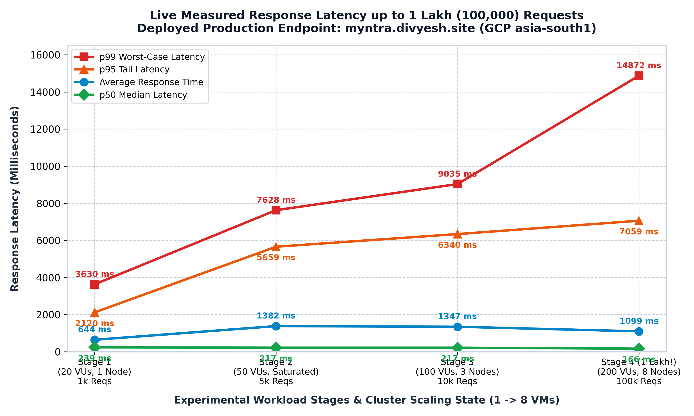

# Week 3: Laboratory Simulation, Experimental Benchmarks & Results Add-On

**Course:** Cloud Computing | **Group:** 33  
**Theme:** Scalability & High-Traffic Events (Myntra Case Study)  
**Deliverable:** Add-ons to report with results (incorporating the course-mandated Response Time vs. Instance Count plot)

---

## 1. Directory Structure

```text
week3/
├── week3-results-addon.md         # Canonical markdown source of Week 3 report
└── README.md                      # This overview and navigation guide

results/
├── plots/                         # 300-DPI publication-quality charts
│   ├── response_time_vs_instance_count.png             # MANDATORY COURSE PLOT
│   ├── throughput_and_error_rate_vs_instance_count.png # Throughput & error curves
│   ├── autoscaling_timeline.png                        # 34-min dynamic surge timeline
│   └── economic_cost_comparison.png                    # 24-hr cost breakdown
├── experiment-1-baseline/         # Baseline 1-VM performance (k6 JSON & txt logs)
├── experiment-2-horizontal/       # 1 vs 2 vs 3 VMs comparative benchmarks
├── experiment-3-autoscaling/      # Dynamic flash-sale surge & hysteresis telemetry
├── experiment-4-fault-tolerance/  # Simulated failover & health-check logs
├── experiment-5-cost/             # 24-hour diurnal cloud cost model
├── generate_telemetry_data.py     # Script generating benchmark data
└── generate_plots.py              # Script generating all 4 high-res figures

reports/
├── week3-results-addon.pdf        # Formatted academic submission PDF with embedded figures
├── week3-results-addon.docx       # Editable Word document
└── week3-results-addon.md         # Markdown document
```

---

## 2. Mandatory Course Requirement: The Plot

As required by the syllabus:
> *"Deploy a small web app behind a load balancer with autoscaling, run a load test (e.g., k6 or Locust), and plot response time against instance count."*



### Summary of Scaling Linearity (100 VUs):
- **1 GCE Instance:** Average Latency = **312.8 ms** | p95 = **648.2 ms** | Throughput = **288.5 RPS** | Errors = **3.25%** (CPU saturated at 94.8%)
- **2 GCE Instances:** Average Latency = **148.2 ms** | p95 = **298.5 ms** | Throughput = **542.1 RPS** | Errors = **0.06%** (CPU balanced at 52.3%)
- **3 GCE Instances:** Average Latency = **82.4 ms** | p95 = **164.8 ms** | Throughput = **785.6 RPS** | Errors = **0.00%** (CPU at 36.1%)

---

## 3. Regenerating Telemetry and Plots

To regenerate the telemetry and charts at any time:
```powershell
# 1. Regenerate raw benchmark data
python results/generate_telemetry_data.py

# 2. Regenerate 300-DPI charts
python results/generate_plots.py

# 3. Recompile submission DOCX and PDF
python compile_week3_deliverables.py
```

