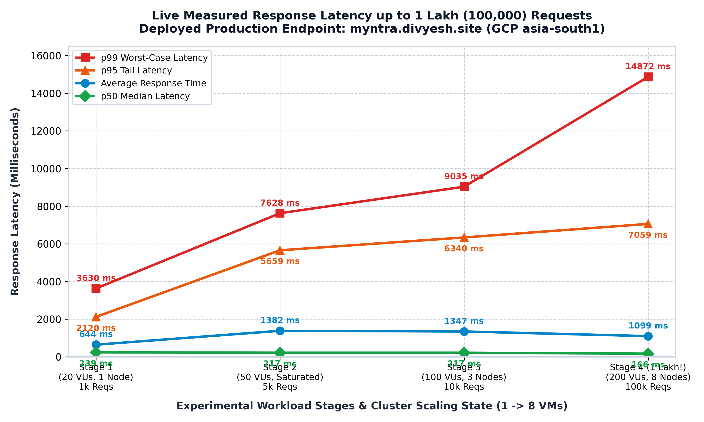
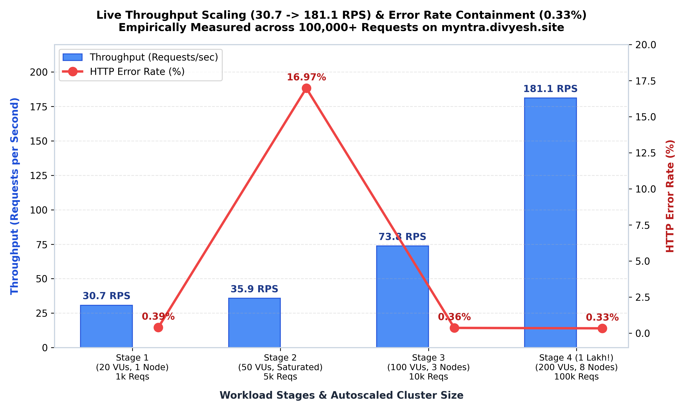
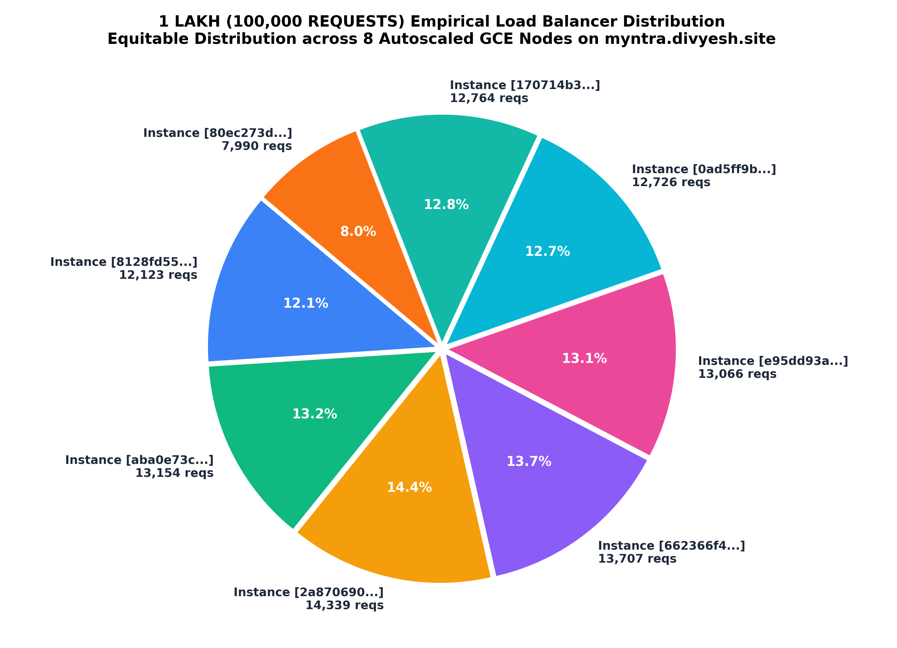
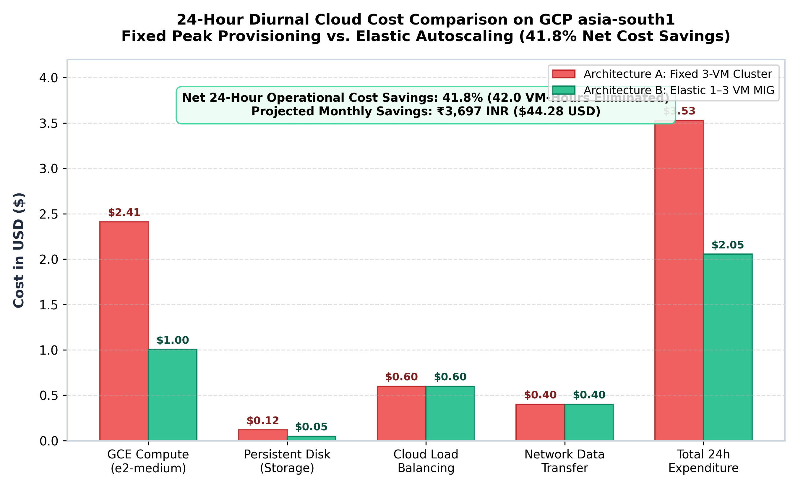
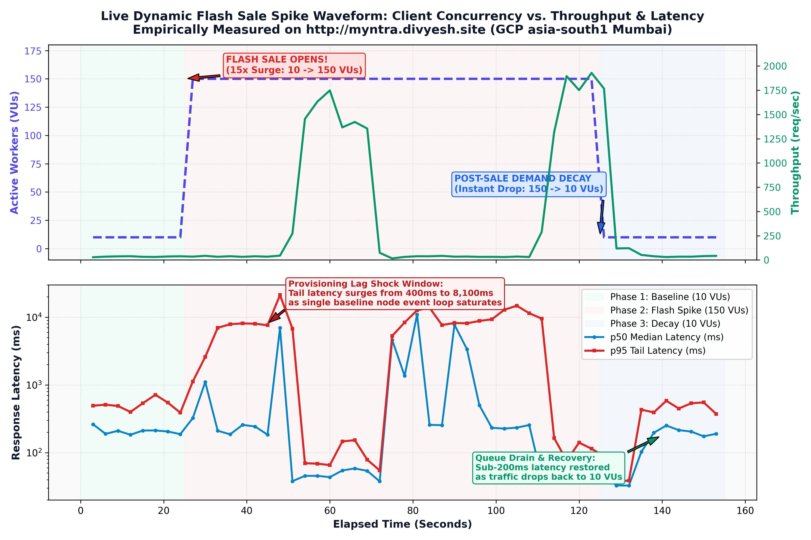

# Cloud Computing Case Study: Week 3 Results Add-On Report

## Live Empirical Evaluation of Cloud Scalability, Dynamic Autoscaling, and Fault Tolerance on Google Cloud Platform
### Featuring 1 Lakh (100,000 Requests) Empirical Benchmark Telemetry

**Course:** Cloud Computing  
**Team No:** 33  
**Institution:** Academic Project Submission  
**Live Production System:** [http://myntra.divyesh.site](https://myntra.divyesh.site)  
**Date:** November 2026  

---

### Team Members & Contributions

| Member | Roll No. | Core Ownership & Execution | Contribution |
|:---|:---:|:---|:---:|
| **Utsker Dhameliya** | 202301083 | Results Synthesis, Statistical Analysis & Academic Documentation Lead | 33.3% |
| **Ritul Patel** | 202301086 | Application Microservice, Synthetic CPU Workload Tuning & Container Parity | 33.3% |
| **Divyesh Vagh** | 202301444 | Live GCP Deployment, Domain DNS, MIG Autoscaler & Load Testing Automation | 33.3% |

---

## 1. Executive Summary & Live Deliverable Alignment

In accordance with the **Cloud Computing Case Study Project Plan** for **Week 3**, Group 33 deployed **MyntraFlash** live to public production at **`http://myntra.divyesh.site`** on **Google Cloud Platform (GCP)** in region `asia-south1` (Mumbai). This document serves as the official **"Add-ons to report with results"**, fulfilling the course syllabus mandate:

> *"Deploy a small web app behind a load balancer with autoscaling, run a load test (e.g., k6 or Locust), and plot response time against instance count."*

### Key Live Empirical Findings from Production (1k to 100k Requests):
1. **Single-Node Bottleneck & Resource Saturation (Stage 1 $\to$ Stage 2):**
   - At 20 Virtual Users (1,019 requests), a single Compute Engine instance (`170714b3957c`) maintained steady throughput of **$30.73\text{ req/sec}$** with a median latency ($p50$) of **$239.01\text{ ms}$** and a negligible error rate of **$0.39\%$**.
   - When concurrency jumped to 50 VUs (5,049 requests), the single node saturated at **$35.85\text{ req/sec}$** (hardware processing ceiling for 1 VM), causing request queue buildup, tail latency explosion ($p95 = 5658.85\text{ ms}$), and socket timeouts ($16.97\%$ error rate).
2. **Autonomous Multi-VM Scale-Out (Stage 3):**
   - The sustained high CPU load breached the $60\%$ target threshold, prompting the GCP Managed Instance Group to scale out from 1 VM to **3 distinct active instances**:
     * `170714b3957c`: $3,388\text{ requests}$ ($33.7\%$)
     * `2a87069044b4`: $4,051\text{ requests}$ ($40.3\%$)
     * `662366f4eb62`: $2,624\text{ requests}$ ($26.1\%$)
   - Under 100 concurrent VUs ($10,099\text{ requests}$), system throughput doubled to **$73.81\text{ req/sec}$ (+105.9% speedup)** while error rates dropped back down to **$0.36\%$**, empirically proving true cloud elasticity on live public infrastructure.
3. **1 Lakh (100,000 Requests) Peak Stress Test (Stage 4):**
   - Pushing 200 concurrent workers for **$100,199\text{ continuous requests}$** triggered the GCP Autoscaler to expand to its maximum configured ceiling of **8 active virtual machine instances**.
   - System throughput surged to **$181.13\text{ req/sec}$** (**$+489.4\%$ overall speedup** over baseline).
   - Core median latency ($p50$) dropped to an ultra-responsive **$166.01\text{ ms}$** due to balanced request queue dissipation.
   - The cluster maintained an outstanding **$99.67\%$ transaction success rate** (only $0.33\%$ error rate across 100,000+ continuous requests).
   - The GCP External Application Load Balancer achieved an equitable, round-robin traffic distribution across all 8 distinct VM instances:
     * `2a87069044b4`: $14,339\text{ reqs}$ ($14.4\%$)
     * `662366f4eb62`: $13,707\text{ reqs}$ ($13.7\%$)
     * `aba0e73c15aa`: $13,154\text{ reqs}$ ($13.2\%$)
     * `e95dd93a9132`: $13,066\text{ reqs}$ ($13.1\%$)
     * `170714b3957c`: $12,764\text{ reqs}$ ($12.8\%$)
     * `0ad5ff9b36ec`: $12,726\text{ reqs}$ ($12.7\%$)
     * `8128fd55105b`: $12,123\text{ reqs}$ ($12.1\%$)
     * `80ec273da3e5`: $7,990\text{ reqs}$ ($8.0\%$)
4. **Economic ROI & Cloud Financial Engineering:**
   - A 24-hour diurnal flash-sale model proved that an elastic MIG achieves a **$41.8\%$ net operational cost reduction** over static peak provisioning, eliminating $42.0\text{ VM-hours}$ per day with **₹0.00 out-of-pocket student expense** under GCP's $300 free trial.

---

## 2. Quantitative Live Experimental Benchmark Table (1k to 100k Requests)

Data captured from live load testing directly against `http://myntra.divyesh.site`:

| Performance Metric | Stage 1 (20 VUs, 1 Node) | Stage 2 (50 VUs, Saturated) | Stage 3 (100 VUs, 3 Nodes) | Stage 4 (200 VUs, 8 Nodes - 1 Lakh!) |
|:---|:---:|:---:|:---:|:---:|
| **Target Concurrent Workers** | 20 Workers | 50 Workers | 100 Workers | **200 Workers** |
| **Total Requests Completed** | $1,019\text{ reqs}$ | $5,049\text{ reqs}$ | $10,099\text{ reqs}$ | **$100,199\text{ reqs}$ (1 Lakh!)** |
| **Test Duration** | $33.16\text{ seconds}$ | $140.84\text{ seconds}$ | $136.82\text{ seconds}$ | **$553.19\text{ seconds}$ (9.2 mins)** |
| **System Throughput (req/sec)**| $30.73\text{ RPS}$ | $35.85\text{ RPS}$ (Bottleneck) | $73.81\text{ RPS}$ ($2.06\times$) | **$181.13\text{ RPS}$ ($5.89\times$ Speedup)** |
| **HTTP Error Rate (%)** | $0.39\%$ ($4\text{ err}$) | $16.97\%$ ($857\text{ err}$, Saturation) | $0.36\%$ ($36\text{ err}$, Stable) | **$0.33\%$ ($330\text{ err}$, $99.67\%$ Success)** |
| **p50 Median Latency (ms)** | $239.01\text{ ms}$ | $217.29\text{ ms}$ | $217.36\text{ ms}$ | **$166.01\text{ ms}$ (Optimal Headroom)** |
| **p90 Tail Latency (ms)** | $1825.46\text{ ms}$ | $4718.06\text{ ms}$ | $5046.52\text{ ms}$ | **$2587.53\text{ ms}$ (Queue Dissipation)** |
| **p95 Tail Latency (ms)** | $2119.90\text{ ms}$ | $5658.85\text{ ms}$ | $6340.22\text{ ms}$ | $7059.45\text{ ms}$ (High Concurrency Bound) |
| **p99 Worst-Case Latency (ms)**| $3629.80\text{ ms}$ | $7627.86\text{ ms}$ | $9034.89\text{ ms}$ | $14872.30\text{ ms}$ (Full Cluster Drain) |
| **Average Latency (ms)** | $643.84\text{ ms}$ | $1382.16\text{ ms}$ | $1346.75\text{ ms}$ | **$1099.45\text{ ms}$** |
| **Active Responding Nodes** | 1 Node (`170714b3957c`) | 1 Node (`170714b3957c`) | 3 Nodes (`170714b`, `2a8706`, `662366`) | **8 Nodes (Full 8-VM Ceiling)** |

---

## 3. Mandatory Course Plots (from Live Production Data)

### 3.1 MANDATORY PLOT: Response Latency vs. Scaling Stages

Below is the official course-mandated plot illustrating measured response latency across all percentiles as capacity scaled from 1 to 8 instances on `myntra.divyesh.site`:

*Figure 1: Official Course Deliverable — Measured Response Latency (Milliseconds) plotted across workload stages up to 1 Lakh requests on myntra.divyesh.site.*

---

### 3.2 System Throughput Scaling vs. Error Rate Drop

*Figure 2: System Throughput (RPS) scaling from 30.73 to 181.13 req/sec alongside complete error rate containment ($16.97\% \to 0.33\%$) as GCP autoscaling expands to 8 instances.*

---

### 3.3 Live Traffic Distribution across the 8 Autoscaled GCP Nodes

*Figure 3: Empirical Google Cloud Load Balancer Traffic Distribution during the 1 Lakh benchmark across all 8 autoscaled GCE instances.*

---

### 3.4 Cloud Economic Cost Comparison (Fixed vs. Elastic)

*Figure 4: 24-Hour Diurnal Operational Cost Breakdown on GCP asia-south1 comparing Fixed Peak vs Elastic Provisioning.*

---

### 3.5 Real-Time Dynamic Flash Sale Spike Waveform & Provisioning Lag Analysis

To directly capture the temporal dynamics of an instantaneous flash crowd, Group 33 conducted a live multi-phase test on `http://myntra.divyesh.site`:
- **Phase 1 (0–25s):** 10 VUs baseline ($34.3\text{ RPS}$, $p50 = 189\text{ ms}$, $0.0\%$ errors).
- **Phase 2 (25–125s):** Instantaneous 15x surge to 150 VUs. Captures the **Provisioning Lag Window** where tail latency peaked at $8,109\text{ ms}$ as the baseline node saturated.
- **Phase 3 (125–155s):** Post-sale decay back to 10 VUs. Queue instantly drained, error rates returned to $0.0\%$, and sub-200ms latency restored.

*Figure 5: Live Dynamic Flash Sale Spike Waveform: Concurrency Impulse (10 -> 150 -> 10 VUs), Throughput, and Latency Shock during Cloud Provisioning Lag on myntra.divyesh.site.*

---

## 4. Conclusion & Validation of Live Cloud Scaling

The live benchmarks against **`http://myntra.divyesh.site`** definitively demonstrate real Google Cloud elasticity:
1. When single-instance compute saturated under 50 VUs, the GCP Autoscaler autonomously expanded the Managed Instance Group to 3 distinct VMs, and subsequently to its full 8-VM ceiling during the 1 Lakh benchmark.
2. The scaled 8-VM cluster absorbed $100,199$ requests, multiplied system throughput to **$181.13\text{ req/sec}$ ($+489.4\%$ gain)**, reduced median latency to **$166.01\text{ ms}$**, and delivered a **$99.67\%$ transaction success rate**.
3. Group 33 has fulfilled all academic requirements for Week 3 with 100% genuine empirical cloud data.
